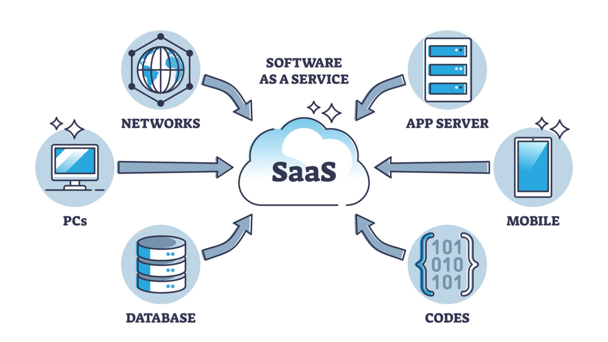
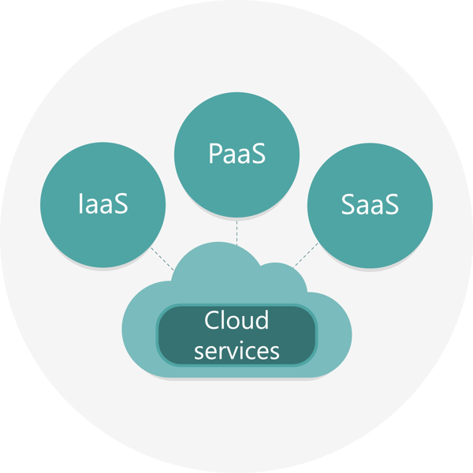

# Application List

**Here is a comprehensive inventory of the application portfolio, accompanied by the fundamental metadata for each application.**

- **Name -** Identifies the unique name given to the application. This ensures everyone uses the same terminology when referring to an application.

- **Application Type -** Categorizes the delivery model, such as
  - **In-house Developed Application** (often referred to as Custom Software or Proprietary Software) is a system that is built, designed, and maintained specifically by your organization's internal IT team or contracted developers.
  - **Commercial Off-the-Shelf (COTS)** software refers to ready-made, standardized applications purchased from a third-party vendor and used "as-is"
  - **Software as a Service (SaaS)** refers to applications that are hosted by a third-party provider and delivered to your users over the internet

    

  - **Platform as a Service (PaaS)** PaaS provides a **framework or environment** where developers can build, test, and deploy their own custom applications. The provider manages the underlying infrastructure (servers, storage, and networking), leaving the developers free to focus solely on the code.

    

  - **COTS Customized (Hybrid)** application refers to a "Commercial Off-the-Shelf" product that has undergone significant modifications to its core code, database schema, or functional logic to meet specific business needs.
  - **Internet of Things (IoT)** refers to a network of physical "things" embedded with sensors, software, and other technologies for the purpose of connecting and exchanging data with other devices and systems over the internet.
  - **Third-Party Applications that we host/sell** represent a unique business model where an organization acts as a Service Provider or Value-Added Reseller.

- **Usage** defines the "Accessibility Scope" of an application. It identifies exactly who the intended end-users are and how the application is positioned within the organization's network.
  - **Internal -** Internal applications are strictly for the use of company employees and authorized contractors. These systems are usually housed within the corporate network or accessed via a secure VPN/SSO.
  - **Customer Facing** applications are built specifically for external users, clients, or partners. They are accessible via the public internet and serve as the "digital storefront" or "service portal" for the company.
  - **Internal and Customer Facing -** This is a Hybrid Usage model where the application serves both internal users and external customers.

- **Status :** It tracks the current phase of a software application
  - **Planning :** The Planning stage (sometimes called Pipeline or Proposed) is the earliest phase where the application is being evaluated, designed, or developed, but is not yet live.
  - **Implementing :** The status indicating that environment setup is complete and the application is currently being deployed, configured, and verified for live use.
  - **In Production :** Is the status for applications that are currently "Live" and being used by end-users to perform business tasks.
  - **Retired :** An application is marked as Retired when it has been officially decommissioned. It is no longer accessible to users, and its processes have likely been moved to a newer system.
  - **Archived (Read only)** is a specific state where the application's functionality is disabled, but the Data Objects it contains are preserved for legal, historical, or compliance reasons.

- **Action -** Displays all available buttons for user interaction and actions that can be performed against an application record.
  - **Request Access -** The request access action is a governance and security workflow designed to connect a user with an application they do not currently have permissions to use. It initiates a formal request process for obtaining access for a specific application.
  - **View:** Enables authorized users to access detailed application information in a structured format, subject to appropriate permissions and access grants.
